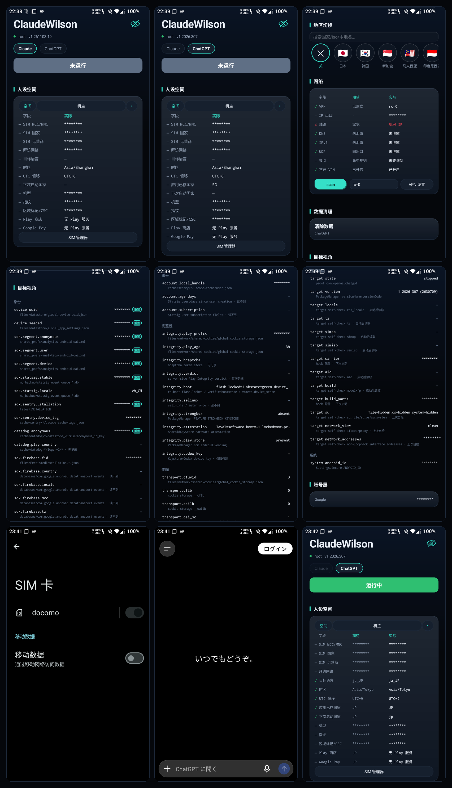

<p align="center">
  
</p>

# ClaudeWilson

**See what Claude and ChatGPT see on Android — then decide what to change.**

ClaudeWilson is a reversible environment observer and aligner. It puts the region, SIM, language, timezone, device model and network egress that a target app reads into one table. Values it can align get a write path; values it cannot align are labelled honestly.

> Not a crack, not a mod. It does not promise "no ban", and it cannot change server-side decisions, TEE or Play Integrity. Use it only on devices you own.

<p align="center">
  <a href="README.md">简体中文</a> ·
  <a href="README.en.md"><b>English</b></a>
</p>

<p align="center">
  
</p>

---

## Contents

**Part I — User guide** (no code knowledge required)

- [What it solves](#what-it-solves)
- [30-second start](#30-second-start)
- [Before you start](#before-you-start)
- [Reading the screen](#reading-the-screen)
- [Region switch and restore](#region-switch-and-restore)
- [Network check](#network-check)
- [Data cleanup and local identity](#data-cleanup-and-local-identity)
- [FAQ](#faq)
- [Privacy and boundaries](#privacy-and-boundaries)

**Part II — Engineering notes** (Java / shell assumed)

- [Design constraints](#design-constraints)
- [Code map](#code-map)
- [One scan](#one-scan)
- [Target model](#target-model)
- [Privileged channels](#privileged-channels)
- [Region transaction](#region-transaction)
- [Data boundaries](#data-boundaries)
- [Build and test](#build-and-test)
- [Adding a target](#adding-a-target)
- [Known limits](#known-limits)

---

# Part I — User guide

## What it solves

Claude and ChatGPT read a lot more than your IP:

- system timezone, language and `persist.sys.timezone`;
- SIM MCC/MNC, country, carrier and the visited network;
- device model, fingerprint, build id and region tag;
- values read inside the target process, such as AID, installation ids and SDK device ids;
- VPN, DNS, IPv6, UDP and the actual egress.

When those values contradict each other, the client environment is inconsistent. ClaudeWilson does two things:

1. **Observe** what the target would see, not just what system properties say.
2. **Align** a self-consistent set for a region, and put the original values back when the region is switched off.

It never launches the target, and it never uploads the result.

## 30-second start

1. Install the APK and open ClaudeWilson.
2. Grant **root** or **Shizuku** (next section).
3. For in-process hooks, enable ClaudeWilson in Vector and add Claude / ChatGPT to its scope.
4. Pick the target at the top: **Claude** or **ChatGPT**.
5. Read the actual values in **Persona space**, then pick a region in **Region switch**.
6. Wait for the app to finish. For in-process values, close the target from recents and open it normally.
7. To stop simulating, tap the `✕` at the left of the region row and wait for the restore.

## Before you start

| Item | Requirement |
|---|---|
| OS | Android 15 (API 35) or newer |
| Target | Claude or ChatGPT installed |
| Privileged channel | root (KernelSU / Magisk) **or** Shizuku |
| Hooks | root + Zygisk + Vector 2.x (Xposed module manager) |
| This app | `com.walter.claudewilson`; no `INTERNET` permission |

### The two channels

| Capability | root | Shizuku (non-root) |
|---|---|---|
| System properties, package state, network state | ✓ | ✓ |
| Timezone, per-app locale for target/browser | ✓ | ✓ |
| Network egress probe | ✓ | ✓ |
| Target private directories, target self-check | ✓ | Partial (external self-check) |
| SIM MCC/MNC, SIM country, carrier | ✓ | ✗ |
| Model / build properties / region tag CSC | ✓ | ✗ |
| Vector in-process hooks | ✓ | ✗ (needs root + Zygisk) |

Shizuku alone can inspect and can change timezone and locale, but it **cannot** change SIM/build properties or load Vector into the target. Use root for full simulation.

KernelSU, first run:

1. Open KernelSU → Superuser and search for `ClaudeWilson`.
2. Turn on its **Superuser** switch.
3. If the switch is grey, open its App Profile, turn off **Unmount modules**, then come back.

On Magisk, grant root when prompted. A green `root` or cyan `Shizuku` at the top means the channel is ready.

Shizuku, first run: allow ClaudeWilson in the Shizuku app. If the header says "Shizuku not granted", tap the header or grant it manually in Shizuku.

## Reading the screen

The order is fixed:

1. **Target**: Claude / ChatGPT. Switching only changes what is inspected; it never launches an app.
2. **Persona space**: field, expected, actual. `✓` matches, `✗` differs, `—` not compared or not possible on this channel.
3. **Region switch**: pick a region; `✕` closes and restores.
4. **Network**: VPN, IP exit, line, DNS, IPv6, UDP, node.
5. **Data cleanup**: clear the target's local data.
6. **Check items**: the target's own observations, grouped by identity / account / integrity / transport / target / system.
7. **Account layer**: account boundaries and local account records.

The eye at the right of the title masks sensitive values (AID, SIM, model, fingerprint, account ids). It only changes what is drawn; writes and verdicts are unaffected.

## Region switch and restore

### Applying a region

Tap the target country/region. The app will:

- disable timezone auto-detection and write the region's timezone;
- write the region's language (root uses the hook; Shizuku writes per-app locale for the target and browser);
- write SIM MCC/MNC, country, carrier and the visited network (root only);
- optionally write model/build properties (root only); the region tag CSC is a separate soft-reboot action, off by default;
- publish the same persona to the Vector module for the target's next start.

After it finishes, **close the target from recents and open it again** so the new values enter the target process.

### Closing the region

Tap the `✕` at the left of the region row. The app restores the baseline captured on the first apply:

- timezone and the auto-timezone switch;
- the three SIM properties and the carrier override;
- per-app locale for the target and the default browser;
- removes the Vector payload, so the next target start is no longer hooked.

**No phone reboot is needed.** After restoring, the app reads the timezone/SIM back and verifies them. If verification fails it shows `PARTIAL`, keeps the baseline, and a second `✕` tap can repair it.

### Two rules that surprise people

- **Changing region clears the current space's manual MCC/MNC and carrier overrides**, so the new region's defaults win. Re-tapping the *same* region keeps them.
- A selected region is device-wide. The other target chip is dimmed until you tap `✕` and close the region.

### About the soft reboot

"Region tag/CSC" is a separate action. It rewrites `ro.product.*.name` and soft-reboots the framework (all apps exit; unlock again). It is not part of a normal region apply and is off by default. A normal region switch never needs it.

## Network check

Tap `scan`. The network card probes from the shell side:

- **VPN**: whether a VpnService is up, and its package;
- **IP exit**: the public IP and country;
- **line**: residential or datacenter IP;
- **DNS**: whether foreign domains resolve to fake-ip;
- **IPv6**: whether external IPv6 leaks;
- **UDP**: whether STUN / UDP egress matches TCP;
- **node**: whether target domains hit the proxy rules;
- **always-on VPN**: the system switch.

Notes:

- `scan` is read-only by itself. If a running VPN is detected, the same tap also performs basic fixes: disable IPv6, clear the system proxy, then re-check. With no VPN it only probes.
- Android 12+ always-on VPN cannot be written through `settings`; the app only reports the state. Use **VPN settings** to turn it on.
- `VPN up` only means a VPN is running; `always-on off` only means the system switch is off.
- If IP exit does not match the region, the node is in another country. Change the node, or select the node's country.
- `DNS unread` means one lookup failed; it is not a leak. Scan again; if it stays unread, check the VPN DNS.

## Data cleanup and local identity

### Clear data

**Data cleanup → clear data**:

- scans the target's internal/external directories for every Android user and lists the real paths in the confirmation dialog;
- stops the target;
- runs `pm clear` for every user that has the target installed;
- removes external `Android/data`, `media` and `obb` directories;
- reads back leftover file counts and only reports success when they are zero.

A privileged channel is required; root is the reliable path, while Shizuku may be denied
`pm clear` by the system and the app reports that failure.
It does not touch Google Play services, the Play Store or the browser. Site data for claude.ai / chatgpt.com inside a browser must be cleared in that browser.

**This is destructive and has no automatic backup.** The target will usually ask you to sign in again.

### Reset local identity

Tap `reset` on an identity item (**reset local identity**). The app stops the target and clears its local data so the next start mints new local ids.

- Requires **root**;
- clears login, sessions and cache;
- does not change the server account, subscription, Play Integrity, hCaptcha or Codex device keys;
- does **not** create a tar backup first — confirm you can lose the data.

## FAQ

**Can I use it with Shizuku but no root?**

Yes, with limits: diagnostics, timezone, per-app locale and network probes work; SIM, build properties, CSC and Vector hooks do not.

**The header says root is not granted.**

KernelSU does not show a Magisk-style prompt. Open KernelSU → Superuser, search `ClaudeWilson`, and turn the switch on. If it is grey, turn off **Unmount modules** in its App Profile first.

**I changed the region but the target did not change.**

The config is read on the target's next start. Fully close it from recents and open it again. On root, also confirm Vector has ClaudeWilson enabled and the target in scope.

**Do I need to reboot the phone?**

No. Region apply and close are runtime writes with read-back. Only the separate "region tag/CSC" action soft-reboots the framework.

**My carrier override disappeared after switching region.**

Intentional: a real region change clears the current space's manual MCC/MNC and carrier override so the new region's defaults apply. Re-tapping the same region keeps them.

**Does closing the region return to the original state?**

Yes. The first apply captures a baseline; `✕` returns to that baseline, not to the previous region. The baseline is captured on the first apply; a changed active SIM subscription refreshes only its SIM fields.

**`VPN up` but `always-on off` — normal?**

Yes. The first is a running VPN; the second is the system always-on switch. Android 12+ always-on must be enabled in system VPN settings.

**Why is `/system/bin/su` still on disk?**

It is not an old SuperSU leftover. KernelSU exposes `/data/adb/ksud` under the same inode as `/system/bin/su`; the control channel needs that entry point. `RootArtifactHooks` hides the file/command view inside the target, but raw native syscalls are outside that guarantee.

**Can it guarantee I will not be banned?**

No. It only reduces client-side contradictions. Server-side risk control, account behaviour, TEE, Play Integrity, hCaptcha and Codex device keys are outside its control.

**Does it read chats, tokens or accounts?**

No. The target model reads fixed file names, fixed keys and a limited set of identifiers; it does not read chat bodies, OAuth tokens, cookie values or passwords. Sensitive values can be masked in the UI.

**Does it work on iPhone?**

No. This is an Android tool.

## Privacy and boundaries

- The app has **no `INTERNET` permission**. Only when you tap `scan` does the shell side contact ipinfo / ip-api / ipify / Google STUN and similar endpoints.
- Results stay on the device: app-private files and `/data/local/tmp/claudewilson/`. No accounts, device identifiers or persona data are uploaded.
- Target diagnostics do not read tokens, cookie values, accounts or file contents; sensitive items are masked in UI/logs.
- The app does not launch the target, does not modify system partitions, and does not forge integrity.
- Use only on devices you own for compatibility testing and environment diagnosis. Check the target's terms and local law yourself.

---

# Part II — Engineering notes

> This half assumes Java, Android shell and a basic build workflow. Users can stop here.

## Design constraints

The code is organised around four hard constraints:

1. **No network**: the manifest has no `INTERNET`. Network probes run on the shell side; the app only receives the result.
2. **Never launch the target**: no `am start` / monkey / attach. Vector loads the module when the target process starts.
3. **Reversible**: capture a baseline before writing; apply and revert both read back, and a command's exit code is not acceptance.
4. **Model separate from Android**: `model/` does not import `android.*` and contains no UI strings. Check items, constraints and verdicts are pure Java.

Target package ids, market URIs and domain rules live only in `model/TargetRegistry`; UI, shell and probes never compare against a package literal.

## Code map

```
app/src/com/walter/claudewilson/
├── MainActivity.java            lifecycle, permissions, broadcasts
├── Dashboard.java               page composition, apply/revert, scan scheduling
├── PersonaPanel.java            persona table, region writes, model/CSC/timezone editors
├── NetworkPanel.java            network card and scan/fix
├── RiskModelPanel.java          target check-item renderer
├── AccountLayerPanel.java       account layer
├── RegionActions.java           baseline snapshot, subscription, restore
├── EnvSession.java              region transaction state (phase/token/baseline)
├── RootShell.java               unified root / Shizuku command channel
├── ShizukuShell.java            Shizuku process channel
├── SystemBuild.java             build and operator property scripts
├── DataClean.java               per-user target data cleanup
├── TargetIdentityReset.java     local identity reset
├── TargetDataEdit.java          reversible single-field ChatGPT DataStore edit
├── Targets.java                 target selection and package state
├── model/                       pure data and rules (35 files)
├── rule/                        pure probe rules (36 files)
├── platform/                    the only device collection layer (5 files)
└── hook/                        Vector module (10 files)
```

The important `model/` types:

- `TargetRegistry` / `TargetSpec`: target description;
- `ChatGptChecklist` / `ClaudeChecklist`: check items and cross-item constraints;
- `RiskModel`: constraint evaluation;
- `Snapshot` / `PlatformFacts` / `TargetEvidence`: immutable input for one scan;
- `CheckItem`: value, source, writability, coverage reason.

## One scan

```
Dashboard.startScan()
  ├─ Targets.refresh()                 package state, version, payload presence
  ├─ TargetEvidenceCollector           pm/dumpsys + name-level store inventory + self-check
  ├─ AndroidSnapshotCollector          one getprop, mounts, packages, attestation, TLS, network
  ├─ ChatGptRiskCollector / ClaudeRiskCollector
  │     ├─ fixed paths/keys read locally
  │     ├─ target hookcheck (only after the target has run)
  │     └─ CheckItem + CheckConstraint → RiskModel
  └─ ScreenUpdates.post → Dashboard.render()
```

A scan produces one immutable `Snapshot`. A target collector reads only fixed fields; the control app's root/mount view is never treated as a target fact.

## Target model

Both checklists are 1:1 data definitions:

| Target | Items | Cross-item constraints |
|---|---:|---:|
| Claude | 67 | 17 |
| ChatGPT | 65 | 22 |

The numbers move with releases. Tests assert breadth and key relations, not the exact count.

Every `CheckItem` value carries:

- `Verdict`: `CONSISTENT` / `CONFLICT` / `BOUNDARY` / `UNKNOWN`;
- `Coverage`: `OBSERVED` / `UNREADABLE` / `NO_RECORD` / `NOT_COVERED` / `SERVER_ONLY` / `STALE`.

The UI shows observed values and sources, not `A ≠ B` comparisons or verdict counts. A missing value must name its reason; it must not be painted as passing.

## Privileged channels

`RootShell` chooses at probe time:

```
su -c id -u  → 0        → root
else Shizuku ready      → shell (uid 2000)
else                     → read-only
```

Capability boundary:

| Operation | root | Shizuku |
|---|---|---|
| `cmd alarm set-timezone` | ✓ | ✓ |
| `cmd locale set-app-locales` | not needed (hook) | ✓ |
| `setprop gsm.sim.operator.*` | ✓ | ✗ |
| carrier-config override | ✓ | usually denied |
| `resetprop ro.*` / build properties | ✓ | ✗ |
| `pm clear` / multi-user actions | ✓ | partial |
| Vector hooks | ✓ | ✗ |

`RootShell.applyRegion` order: disable auto timezone → write timezone → (non-root) target/browser locale → (root) build or operator properties → carrier override → (root) SIM properties / simop. Any failed step becomes part of the `Outcome`; the caller decides whether to roll back.

## Region transaction

`EnvSession` is the only source of truth, stored in the `apply` SharedPreferences:

```
phase: OFF | APPLYING | ACTIVE | REVERTING | PARTIAL
token: monotonic; an older apply cannot publish after a newer action
baseline: captured on first apply; only the target for OFF
active: current iso / zone / locale / applied
```

Flow:

```
apply:
  startApply()  → token++, phase=APPLYING
  saveOriginal() → capture baseline on first apply
  RootShell.applyRegion()  [serialized by txLock]
  token still current? → finishApply(ok) → ACTIVE / PARTIAL

revert:
  startRevert() → token++, phase=REVERTING
  prepareRestore() → baseline / subscription / target
  RootShell.revert() [serialized by txLock]
  read back tz / SIM → finishRevert(ok) → OFF (clear baseline) or PARTIAL (keep)
```

Key properties:

- `Dashboard.txLock` prevents apply and revert from interleaving shell writes.
- The token discards the result of an apply that finished after the user tapped close.
- The baseline is updated only on the first apply or a changed active subscription; a repeat apply does not turn the simulated values into a new baseline.
- A failed read-back is not success: revert keeps the baseline and reports `PARTIAL` instead of deleting the snapshot.
- A real region change calls `clearSimOverrides()`, removing `root_op.<user>` / `root_carrier.<user>` for the current Android user. Re-tapping the same region keeps them.

## Data boundaries

What the app reads/writes:

| Path | Purpose |
|---|---|
| `SharedPreferences("apply")` | EnvSession, PersonaState, audit/backup pointers |
| `SharedPreferences("targets")` | selected target |
| `SharedPreferences("privacy")` | mask toggle |
| `files/` | audit log, crash log |
| `/data/local/tmp/claudewilson/<target>.json` | payload for Vector |
| `/data/local/tmp/claudewilson/backup/` | single-field edit backups |
| `/data/local/tmp/ssaid_orig_<user>` | AID restore snapshot |

It does not write system partitions, target private data (except explicit cleanup/single-field edits), accounts, tokens or cookie values.

Target collectors read fixed names and fixed keys; `TargetEvidence` carries no file contents. `Privacy` masking is a UI layer; it does not change the model or writes.

## Build and test

There is no Gradle. `app/build.py` drives `javac + d8 + aapt2 + apksigner`.

```bash
cd app
export CW_WORKSPACE=/path/to/android/toolchain   # aapt2 / d8 / apksigner
export CW_JBR=/path/to/jdk-21
python build.py
```

Output: `app/out/build-<timestamp>-<hash>/ClaudeWilson.apk`.

Tests:

```bash
cd app
python test.py
```

They cover model / rule / state machine / shell-command construction and need no device. Current count: 402 assertions (moves with releases).

Install:

```bash
adb install -r app/out/build-*/ClaudeWilson.apk
```

The build also asserts that the manifest permission set stays fixed and that the DEX contains no out-of-scope network/location API.

## Adding a target

1. Add a `TargetSpec` to `model/TargetRegistry` (id, package, market URI, domain rule, support level).
2. For target-specific checks, add an `XxxChecklist` and `XxxRiskCollector`; do not add a target branch to `Dashboard`.
3. For in-process hooks, route through `hook/HookEntry` by `TargetSpec`; do not scatter package-literal checks.
4. Add fixtures covering at least "not installed", "not running" and "field unreadable".

Support levels:

| Level | Capability |
|---|---|
| `diagnostic` | read-only, no payload |
| `environment` | hooks + region/persona writes, no local identity operations |
| `full` | environment + data cleanup / local identity operations |

## Known limits

- Play Integrity verdict, hCaptcha, Codex device keys, account graph and server-side risk control are **server-side values**; local hooks cannot change them.
- TEE / StrongBox / hardware attestation can be observed, not forged.
- Raw native syscalls, `dl_iterate_phdr` and native `posix_spawn` are outside user-mode hooks.
- `/system/bin/su` remains on disk: KernelSU's direct-su architecture. Hiding it inside the target is not the same as removing the file.
- Closing the region restores the **baseline of the first apply**, not "the previous region" and not factory settings.
- A region change discards the current space's manual SIM overrides; they are not restored if the apply fails.

---

<p align="center"><sub>ClaudeWilson · environment observation and reversible alignment · Android 15+</sub></p>
