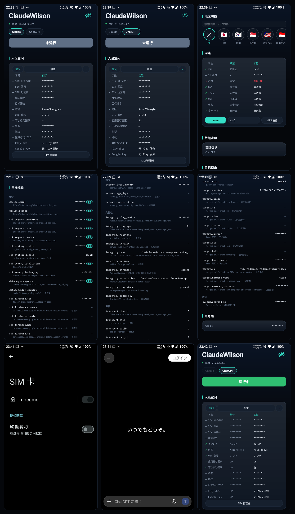

<p align="center">
  
</p>

# ClaudeWilson

**Claude / ChatGPT Android 环境模拟器**

ClaudeWilson 是一个可逆的环境观测与对齐工具。它把目标应用会读取的地区、SIM、语言、时区、机型和网络出口集中到一张表里；能对齐的给出写入路径，不能对齐的明确标出来。

<p align="center">
  <a href="README.md"><b>简体中文</b></a> ·
  <a href="README.en.md">English</a>
</p>

<p align="center">
  
</p>

---

## 目录

**第一部分 · 使用手册**（不需要读代码）

- [它解决什么问题](#它解决什么问题)
- [30 秒上手](#30-秒上手)
- [准备什么](#准备什么)
- [界面怎么读](#界面怎么读)
- [地区切换与恢复](#地区切换与恢复)
- [网络检查](#网络检查)
- [数据清理与本地身份](#数据清理与本地身份)
- [常见问题](#常见问题)
- [隐私与边界](#隐私与边界)

**第二部分 · 工程说明**（假设你会读 Java / shell）

- [设计约束](#设计约束)
- [代码地图](#代码地图)
- [一次扫描](#一次扫描)
- [目标模型](#目标模型)
- [特权通道](#特权通道)
- [地区事务](#地区事务)
- [数据边界](#数据边界)
- [构建与测试](#构建与测试)
- [新增目标](#新增目标)
- [已知边界](#已知边界)

---

# 第一部分 · 使用手册

## 它解决什么问题

Claude 和 ChatGPT 都会从 Android 读取大量环境信号。它们不只看 IP：

- 系统时区、语言、`persist.sys.timezone`；
- SIM 的 MCC/MNC、国家、运营商，以及“拜访网络”；
- 机型、指纹、构建号、区域标记；
- 目标进程自己读到的值，例如 AID、安装 ID、SDK 设备标识；
- 目标进程的定位：地区中心坐标、精确/粗略权限下的不同精度；
- VPN、DNS、IPv6、UDP 和实际出口。

这些值互相矛盾时，客户端环境就不一致。ClaudeWilson 做两件事：

1. **观测**：把“目标会看到什么”列出来，而不是只列系统属性。
2. **对齐**：按地区写入一组自洽的值，并且在关闭地区时恢复原状。

它不会替你启动目标，也不会把结果上传到任何服务器。

## 30 秒上手

1. 安装 APK，打开 ClaudeWilson。
2. 授予 **root** 或 **Shizuku** 权限（见下一节）。
3. 如果要进程内注入，在 Vector 中启用 ClaudeWilson，并把 Claude / ChatGPT 加入 scope。
4. 顶部选择目标：**Claude** 或 **ChatGPT**。
5. 先在“人设空间”看实际值，再在“地区切换”选目标地区。
6. 等应用完成。需要目标进程内生效时，从最近任务关掉目标，再正常打开。
7. 不再需要模拟时，点地区行最左边的 `✕`，等恢复完成。

## 准备什么

| 项目 | 要求 |
|---|---|
| 系统 | Android 15（API 35）或更新 |
| 目标 | 已安装 Claude 或 ChatGPT |
| 特权通道 | root（KernelSU / Magisk）**或** Shizuku |
| 注入 | root + Zygisk + Vector 2.x（Xposed 模块管理器） |
| 本应用 | `com.walter.claudewilson`，无 `INTERNET` 权限 |

### 两种通道

| 能力 | root | Shizuku（非 root） |
|---|---|---|
| 读取系统属性、包状态、网络状态 | ✓ | ✓ |
| 改时区、改目标/浏览器 per-app locale | ✓ | ✓ |
| 网络出口探测 | ✓ | ✓ |
| 目标私有目录、目标进程自检 | ✓ | 部分（外部 self-check） |
| SIM MCC/MNC、SIM 国家、运营商 | ✓ | ✗ |
| 机型 / 构建属性 / 区域标记 CSC | ✓ | ✗ |
| Vector 进程内注入 | ✓ | ✗（需要 root + Zygisk） |

只装 Shizuku 也能看诊断、改时区和语言，但**不能**改 SIM、构建属性，也不能让 Vector 在目标进程里生效。需要完整模拟时用 root。

KernelSU 第一次使用：

1. 打开 KernelSU → 超级用户，搜索 `ClaudeWilson`；
2. 打开“超级用户”开关；
3. 如果开关是灰色，先在 App Profile 里关闭“卸载模块”，再回来开启。

Magisk 按提示授权即可。顶部显示绿色 `root` 或青色 `Shizuku` 就表示通道可用。

Shizuku 第一次使用：在 Shizuku 应用里允许 ClaudeWilson；如果顶部显示“Shizuku 未授权”，点一下应用顶部的状态，或到 Shizuku 里手动授权。

## 界面怎么读

从上到下是固定的顺序：

1. **目标**：Claude / ChatGPT。切换只改变诊断对象，不启动应用。
2. **人设空间**：字段、期望值、实际值。`✓` 一致，`✗` 不一致，`○` 边界，`—` 不比较或当前通道做不到。“定位”行显示目标应看到的城市，点开可开关模拟并查看坐标。
3. **地区切换**：选地区；`✕` 关闭并恢复。
4. **网络**：VPN、IP 出口、线路、DNS、IPv6、UDP、节点。
5. **数据清理**：清除目标本地数据。
6. **检查项**：目标自己的观测行，按身份 / 账号 / 完整性 / 传输 / 目标 / 系统 / 权限 / 定位分组。
7. **账号层**：账号边界和本地账号记录。

标题右边的小眼睛会遮住敏感值（AID、SIM、机型、指纹、账号标识）。它只影响显示，不影响写入和判定。

### 权限与定位观测

“目标视角”现在多出两组只读行：

- **权限**：`permission.location.fine` / `coarse` / `background`、日历、麦克风、健康、屏幕捕获、
  Wi-Fi（`NEARBY_WIFI_DEVICES`）、蓝牙扫描/连接、活动识别、身体传感器。
  值分 `granted`、`denied`、`not-requested`、`approximate`；`not-requested` 不是拒绝。
- **定位**：系统定位模式、provider 列表、目标 AppOps、mock 状态、最近一次目标定位请求
  （来自目标进程自检的 `location_served` / `location_last`）。`location.provider` 后面的
  `(mode off)` 表示系统定位开关关闭，provider 表可能只是历史值；`location.appops` 需要
  root 或 Shizuku 才能读到目标的值。

普通权限只能看到 manifest 声明；目标是否真的被授予、AppOps 是否放行，需要 shell 通道。
没有通道时行显示 `—`，不会画成“拒绝”。

## 地区切换与恢复

### 选一个地区

点目标国家/地区，应用会：

- 关闭时区自动检测，写入该地区的时区；
- 写入该地区的语言（root 走注入；Shizuku 写目标/浏览器的 per-app locale）；
- 写 SIM 的 MCC/MNC、国家、运营商，以及拜访网络（需要 root）；
- 可选地写机型/构建属性（需要 root）；区域标记 CSC 是单独的软重启动作，默认不做；
- 把地区中心坐标写进人设；目标有精确定位权限时返回该点，只有粗略权限时返回 3 km 网格；
- 把同一份人设发布给 Vector 模块，目标下次启动时读取。

应用完成后，**从最近任务关掉目标再打开**，新值才会进入目标进程。

### 关闭地区

点地区行最左边的 `✕`。应用会按第一次 apply 时保存的 baseline 恢复：

- 时区 + 自动时区开关；
- SIM 的三项属性、运营商覆盖；
- 目标和默认浏览器的 per-app locale；
- 删除 Vector 配置，下一次启动目标时不再注入。

**不需要重启手机。** 恢复后会回读时区/SIM 并校验；校验不过会显示 `PARTIAL`，baseline 保留，方便再点一次 `✕` 修复。

### 两个容易踩的规则

- **换地区会清掉当前空间手动填的 MCC/MNC 和运营商**，让新地区的默认值生效；在同一个地区上再点一次，会保留手动值。
- **“定位”开关按空间保存**；关闭只改变下一次发布的人设，已经在运行的目标进程要重启后才会恢复读取系统定位。
- 地区一旦选中就是设备级状态；此时另一个目标标签会变暗，必须先点 `✕` 关闭地区，才能切换目标。

### 关于软重启

“区域标记/CSC”是单独的动作，会改 `ro.product.*.name` 并软重启框架（所有应用退出、需要重新解锁）。它不在正常地区 apply 里，默认不勾选。普通换地区不需要软重启。

## 网络检查

点 `scan` 后，网络卡通过 shell 侧探测：

- **VPN**：当前是否有 VpnService，以及包名；
- **IP 出口**：公网看到的 IP 和国家；
- **线路**：住宅 IP 还是机房 IP；
- **DNS**：国外域名是否走 fake-ip；
- **IPv6**：是否有外部 IPv6 泄漏；
- **UDP**：STUN / UDP 出口是否和 TCP 一致；
- **节点**：目标域名是否命中代理规则；
- **常开 VPN**：系统设置里的 always-on 状态。

注意：

- `scan` 本身只读；如果检测到正在运行的 VPN，同一次点击还会执行基础修复：关闭 IPv6、清理系统代理，然后重新检测。没有 VPN 时只检测。
- Android 12+ 的 always-on VPN 不能靠 `settings` 写入，应用只会显示状态，开关请到“VPN 设置”里手动打开。
- `VPN up` 只表示 VPN 在运行；`常开 VPN off` 只表示系统开关没开。
- IP 出口和地区不一致，说明节点不在目标地区。换节点，或把地区改成节点所在国家。
- `DNS unread` 表示某个域名解析失败，不等于泄漏；再 scan 一次，持续失败就检查 VPN 的 DNS。

## 数据清理与本地身份

### 清除数据

“数据清理 → 清除数据”会：

- 先扫描目标在当前设备各用户下的内部/外部目录，并在确认框里列出真实路径；
- 停止目标；
- 对每个安装了该目标的用户执行 `pm clear`；
- 删除外部 `Android/data`、`media`、`obb` 目录；
- 回读残留文件数，确认清干净才报成功。

需要特权通道；root 最稳，Shizuku 下 `pm clear` 可能被系统拒绝，应用会如实报失败。
它不会动 Google Play 服务、Play 商店和浏览器。浏览器里的 claude.ai / chatgpt.com 站点数据需要你在浏览器内自行清理。

**这是破坏性操作，没有自动备份。** 清完后目标通常需要重新登录。

### 重置本地身份

在检查项里对身份项点 `重置`（“重置本地身份”），会停止目标并清除它的本地数据，让下次启动重新生成本地 ID。

- 需要 **root**；
- 会清掉登录、会话和缓存；
- 不会改变服务端账号、订阅、Play Integrity、hCaptcha 或 Codex 设备密钥；
- 不会先做 tar 备份，请自己确认数据可以丢。

## 常见问题

**Q：没有 root，只有 Shizuku 能用吗？**

能，但能力有限：诊断、时区、per-app locale、网络探测可用；SIM、构建属性、CSC 和 Vector 注入不可用。

**Q：顶部显示 root 未授权？**

KernelSU 默认不弹窗。到 KernelSU → 超级用户里搜索 `ClaudeWilson`，手动打开开关；灰色时先在 App Profile 里关闭“卸载模块”。

**Q：改了地区，目标里没变化？**

配置在目标下次启动时读取。先完全关掉目标（从最近任务划掉），再打开。root 用户还要确认 Vector 已启用 ClaudeWilson，并把目标加入 scope。

**Q：需要重启手机吗？**

不需要。地区 apply / 关闭都走运行时写入和回读。只有你主动做“区域标记/CSC”的软重启，才会重启框架。

**Q：换地区后，我之前填的运营商没了？**

这是有意的：换地区会清除当前空间的手动 MCC/MNC 和运营商覆盖，改用新地区默认值。同一地区重复点会保留。

**Q：关闭地区后，能回到“最开始”的状态吗？**

能。第一次 apply 时会保存 baseline；点 `✕` 回到这份 baseline，而不是回到上一个地区。baseline 在第一次 apply 时抓取；活动 SIM 订阅变化时只更新 SIM 部分。

**Q：`VPN up` 但 `常开 VPN off`，正常吗？**

正常。前者是 VPN 在运行，后者是系统 always-on 开关。Android 12+ 的 always-on 需要到系统 VPN 设置里手动开。

**Q：`/system/bin/su` 还在磁盘上？**

它不是旧 SuperSU 残留。KernelSU 把 `/data/adb/ksud` 以同一 inode 暴露成 `/system/bin/su`；控制面需要这个入口。目标进程内由 `RootArtifactHooks` 隐藏文件/命令视图，但 raw native syscall 不在保证内。

**Q：能保证不封号吗？**

不能。它只减少客户端环境自相矛盾。服务端风控、账号行为、TEE、Play Integrity、hCaptcha、Codex 设备密钥都不由它控制。

**Q：会读聊天内容、token 或账号吗？**

不会。目标模型读取固定文件名、固定键和有限的标识值；不读聊天正文、OAuth token、cookie 值或账号密码。敏感值在界面上可以一键遮住。

**Q：iPhone 能用吗？**

不能，这是 Android 工具。

## 隐私与边界

- 本应用**没有 `INTERNET` 权限**；只有你点 `scan` 时，才通过 shell 侧访问 ipinfo / ip-api / ipify / Google STUN 等端点。
- 诊断结果只在本机显示，写入本应用私有目录和 `/data/local/tmp/claudewilson/`；不上传账号、设备标识或人设数据。
- 目标诊断不读 token、cookie 内容、账号或文件正文；敏感项在 UI/日志中 masked。
- 定位模拟只在目标进程里构造假坐标，**不读取本机真实定位**；关闭模拟后目标恢复读取系统定位。
- 本应用不启动目标应用；不修改系统分区；不做完整性伪造。
- 只用于自有设备上的兼容性测试和环境排查。请自行确认目标应用的服务条款和当地法律。

---

# 第二部分 · 工程说明

> 这一部分假设你会读 Java、Android shell 和基本的编译流程。普通用户到这里就可以停了。

## 设计约束

代码围绕四条硬约束组织：

1. **不联网**：Manifest 没有 `INTERNET`。网络探测在 shell 侧完成，应用只接收结果。
2. **不启动目标**：没有 `am start` / monkey / attach；注入由 Vector 在目标进程启动时加载。
3. **可逆**：写系统前保存 baseline；apply / revert 都有回读，不以命令返回码当成功。
4. **模型与 Android 解耦**：`model/` 不 import `android.*`，不写 UI 文案；检查项、约束和判定都在纯 Java 里。

目标包名、市场 URI、域名规则只出现在 `model/TargetRegistry`；UI、shell 和 probe 不写目标包名字面值。

## 代码地图

```
app/src/com/walter/claudewilson/
├── MainActivity.java            生命周期、权限、广播
├── Dashboard.java               页面编排、apply/revert 事务、扫描调度
├── PersonaPanel.java            人设表、地区写入、机型/CSC/时区编辑
├── NetworkPanel.java            网络卡与 scan/fix
├── RiskModelPanel.java          目标检查项渲染
├── AccountLayerPanel.java       账号层
├── RegionActions.java           baseline 快照、订阅、恢复
├── EnvSession.java              地区事务状态（phase/token/baseline）
├── RootShell.java              root / Shizuku 统一命令通道
├── ShizukuShell.java           Shizuku 进程通道
├── SystemBuild.java            构建属性与运营商属性脚本
├── DataClean.java              按用户清理目标数据
├── TargetIdentityReset.java    本地身份重置
├── TargetDataEdit.java         ChatGPT DataStore 单字段可逆写入
├── Geo.java                    地区坐标资产加载
├── Targets.java                目标选择与包状态
├── model/                      纯数据与纯规则（44 个文件）
├── rule/                       纯规则 probe（36 个文件）
├── platform/                   唯一设备采集层（5 个文件）
└── hook/                       Vector 模块（16 个文件）
```

`model/` 下最重要的是：

- `TargetRegistry` / `TargetSpec`：目标描述；
- `ChatGptChecklist` / `ClaudeChecklist`：检查项与跨项约束；
- `RiskModel`：约束求值；
- `Snapshot` / `PlatformFacts` / `TargetEvidence`：一次扫描的不可变输入；
- `CheckItem`：值、来源、可改性、覆盖原因；
- `GeoTable` / `LocationPlan`：地区坐标表与确定性定位（抖动、粗略网格）。

## 一次扫描

```
Dashboard.startScan()
  ├─ Targets.refresh()                 包状态、版本、payload 是否存在
  ├─ TargetEvidenceCollector           pm/dumpsys + 名称级 store 清单 + 目标 self-check
  ├─ AndroidSnapshotCollector          一次 getprop、挂载、包、attestation、TLS、网络
  ├─ ChatGptRiskCollector / ClaudeRiskCollector
  │     ├─ 固定路径/固定键的本地观测
  │     ├─ 目标进程 hookcheck（运行过才有）
  │     └─ CheckItem + CheckConstraint → RiskModel
  └─ ScreenUpdates.post → Dashboard.render()
```

扫描结果是一个不可变 `Snapshot`。目标 collector 只读固定字段，不把控制面的 root/mount 视角当成目标事实。

## 目标模型

两套 checklist 都是 1:1 数据定义：

| 目标 | 检查项 | 跨项约束 |
|---|---:|---:|
| Claude | 84 | 17 |
| ChatGPT | 82 | 22 |

数字随版本变化，测试只断言“足够宽”和关键关系，不把数字写死。

`CheckItem` 的每个值带：

- `Verdict`：`CONSISTENT` / `CONFLICT` / `BOUNDARY` / `UNKNOWN`；
- `Coverage`：`OBSERVED` / `UNREADABLE` / `NO_RECORD` / `NOT_COVERED` / `SERVER_ONLY` / `STALE`。

UI 只显示观察值和来源，不显示 `A ≠ B` 比较，也不显示判定计数。没有值的行必须说明原因，不能伪装成通过。

## 特权通道

`RootShell` 在 probe 时二选一：

```
su -c id -u  → 0        → root
否则 Shizuku ready      → shell (uid 2000)
否则                     → read-only
```

能力边界：

| 操作 | root | Shizuku |
|---|---|---|
| `cmd alarm set-timezone` | ✓ | ✓ |
| `cmd locale set-app-locales` | 不需要（走 hook） | ✓ |
| `setprop gsm.sim.operator.*` | ✓ | ✗ |
| carrier-config override | ✓ | 通常被拒 |
| `resetprop ro.*` / 构建属性 | ✓ | ✗ |
| `pm clear` / 多用户操作 | ✓ | 部分 |
| Vector 注入 | ✓ | ✗ |

`RootShell.applyRegion` 的顺序是：关自动时区 → 写时区 →（非 root）写目标/浏览器 locale →（root）写构建或运营商属性 → carrier override →（root）写 SIM 属性 / simop。任一步失败都会进入 `Outcome`，由上层决定回滚。

## 地区事务

`EnvSession` 是唯一真值，存在 `apply` SharedPreferences：

```
phase: OFF | APPLYING | ACTIVE | REVERTING | PARTIAL
token: 单调递增，旧 apply 完成后不能覆盖新状态
baseline: 第一次 apply 时抓取，OFF 只回到它
active: 当前 iso / zone / locale / applied
```

流程：

```
apply:
  startApply()  → token++, phase=APPLYING
  saveOriginal() → 首次抓 baseline
  RootShell.applyRegion()  [txLock 串行]
  token 仍当前? → finishApply(ok) → ACTIVE / PARTIAL

revert:
  startRevert() → token++, phase=REVERTING
  prepareRestore() → baseline / 订阅 / 目标
  RootShell.revert() [txLock 串行]
  回读 tz / SIM → finishRevert(ok) → OFF（清 baseline）或 PARTIAL（保留）
```

关键点：

- `Dashboard.txLock` 让 apply 和 revert 不会交叉写 shell。
- token 让“用户已经点了关闭”之后的旧 apply 结果被丢弃。
- baseline 只在第一次 apply 或活动订阅变化时更新；普通重复 apply 不会把当前模拟值当成新 baseline。
- 回读失败不算成功：revert 会保留 baseline 并标 `PARTIAL`，而不是删掉快照。
- 换地区时 `clearSimOverrides()` 删除当前 Android 用户的 `root_op.<user>` / `root_carrier.<user>`；同地区重复点不清。

## 数据边界

应用会读写的位置：

| 路径 | 用途 |
|---|---|
| `SharedPreferences("apply")` | EnvSession、PersonaState、审计/备份指针 |
| `SharedPreferences("targets")` | 当前目标 |
| `SharedPreferences("privacy")` | 遮罩开关 |
| `files/` | 审计日志、崩溃日志 |
| `/data/local/tmp/claudewilson/<target>.json` | 发布给 Vector 的 payload |
| `/data/local/tmp/claudewilson/backup/` | 单字段编辑的备份 |
| `/data/local/tmp/ssaid_orig_<user>` | AID 还原快照 |

不写：系统分区、目标私有数据（除显式清理/单字段编辑）、账号、token、cookie 值。

目标 collector 只读固定名称和固定键；`TargetEvidence` 不携带文件内容。`Privacy` 的遮罩是 UI 层，模型和写入不变。

## 构建与测试

没有 Gradle。`app/build.py` 直接用 `javac + d8 + aapt2 + apksigner` 出 APK。

```bash
cd app
export CW_WORKSPACE=/path/to/android/toolchain   # aapt2 / d8 / apksigner
export CW_JBR=/path/to/jdk-21
python build.py
```

产物：`app/out/build-<timestamp>-<hash>/ClaudeWilson.apk`。

自测：

```bash
cd app
python test.py
```

测试覆盖 model / rule / 状态机 / shell 命令构造，不依赖设备。当前 402 项断言（数字随版本变化）。

安装：

```bash
adb install -r app/out/build-*/ClaudeWilson.apk
```

构建脚本还会检查：Manifest 权限集合固定、DEX 不出现越界的网络/定位 API。

## 新增目标

1. 在 `model/TargetRegistry` 增加一个 `TargetSpec`（id、包名、市场 URI、域名规则、支持级别）。
2. 如果需要目标专属检查，新增 `XxxChecklist` 和 `XxxRiskCollector`；不要改 `Dashboard` 的目标分支。
3. 如果需要进程内 hook，在 `hook/HookEntry` 按 `TargetSpec` 路由；不要按包名字面值散落判断。
4. 加测试 fixture，至少覆盖“目标未安装”“目标未运行”“字段读不到”三种状态。

支持级别：

| 级别 | 能力 |
|---|---|
| `diagnostic` | 只读，不发布配置 |
| `environment` | hooks + 地区/人设写入，无本地身份操作 |
| `full` | environment + 数据清理 / 本地身份操作 |

## 已知边界

- Play Integrity verdict、hCaptcha、Codex 设备密钥、账号图谱、服务端风控：**服务端量**，本地改不了。
- TEE / StrongBox / 硬件 attestation：只能观测，不能伪造。
- raw native syscall、`dl_iterate_phdr`、native `posix_spawn`：用户态 hook 覆盖不到。
- `/system/bin/su` 仍在磁盘：KernelSU direct-su 架构；目标进程内隐藏不等于磁盘不存在。
- 关闭地区恢复的是**第一次 apply 的 baseline**，不是“上一个地区”，也不是出厂设置。
- 换地区会丢弃当前空间的手动 SIM 覆盖；apply 失败时这些覆盖不会自动恢复。

---

<p align="center"><sub>ClaudeWilson · 环境观测与可逆对齐 · Android 15+</sub></p>
